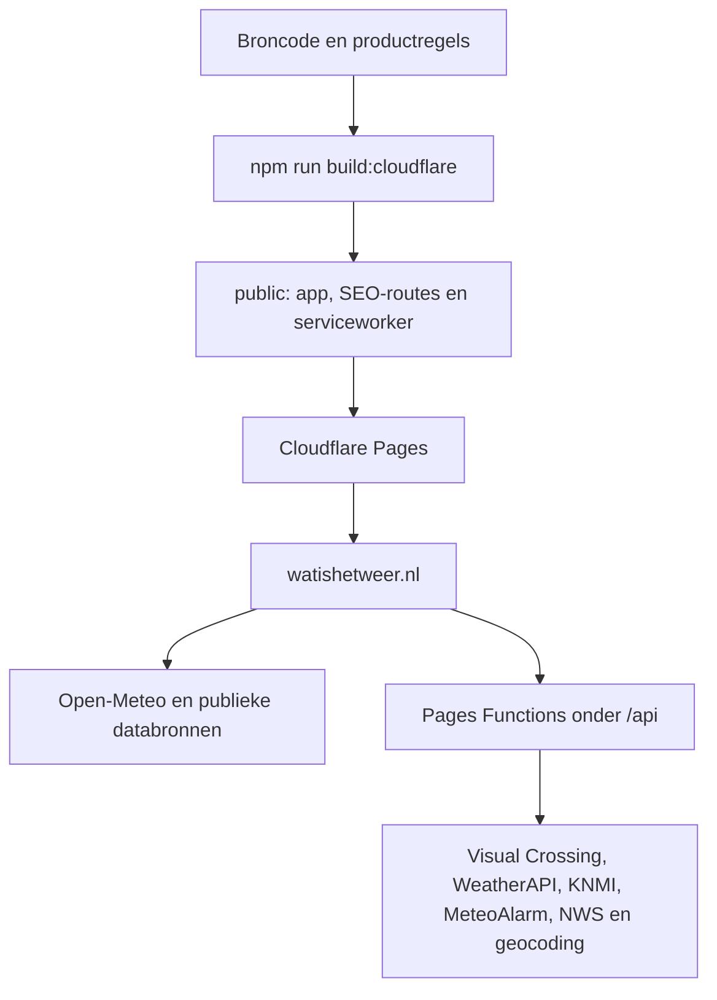

# Overdracht en beheer

Dit document is de operationele ingang voor een nieuwe eigenaar of beheerder van watishetweer.nl. Het bevat geen geheime waarden. Controleer bij een overdracht de accounttoegang en actuele facturen rechtstreeks bij de betreffende leveranciers.

## Product en eigendom

- Canonieke repository: `Tommjoness/watishetweer`.
- Productiedomein: `https://watishetweer.nl/`.
- `https://www.watishetweer.nl/` hoort permanent naar het apexdomein te verwijzen.
- Productieplatform: Cloudflare Pages met Pages Functions.
- Cloudflare Pages-project: `watishetweer`.
- Productiebranch: `main`.
- De live HTML bevat `meta[name="weather-build-sha"]`; die waarde moet gelijk zijn aan de bedoelde `main`-SHA.

Bij verkoop moeten afzonderlijk worden overgedragen of opnieuw worden ingericht: de GitHub-repository, het Cloudflare-account of de Cloudflare-zone en Pages-projecttoegang, het domein bij de registrar, GitHub Actions-secrets en Google Search Console. Domeinregistratie en Search Console staan niet in deze repository.

## Architectuur

De browserapp is statische HTML, CSS en JavaScript. De build stelt de bronlagen samen, genereert de SEO-plaatsroutes en schrijft het definitieve Cloudflare-artifact naar `public/`. Bewerk `public/` niet handmatig.



Belangrijkste onderdelen:

| Onderdeel | Eigenaar in de code |
|---|---|
| hoofdtemplate en browserruntime | `index.html` |
| interpretatie en consumententaal | `interpretatie-engine.js`, `interpretatie.js`, `nederlandse-weergrammatica.js` |
| productie-assemblage | `build-weather.js`, `scripts/postbuild-pipeline.js` |
| plaatsroutes, canonicals en sitemap | `scripts/seo-locations.config.js`, `scripts/generate-seo-location-pages.js` |
| Cloudflare Pages Functions | `functions/`, gedeelde logica in `api/` en `lib/` |
| statische headers en Function-routing | `cloudflare/_headers`, `cloudflare/_routes.json`, `functions/_middleware.js` |
| serviceworker en offline shell | `sw.js`, met een buildgebonden cacheversie in het artifact |
| Pages-projectconfig | `wrangler.jsonc` |
| deploy en domeinkoppeling | `.github/workflows/cloudflare-production.yml` |
| Web Analytics setup | `.github/workflows/cloudflare-web-analytics.yml`, `scripts/cloudflare-web-analytics-setup.js` |
| previewdeployments | `.github/workflows/cloudflare-preview.yml` (secretloze PR-build) en `.github/workflows/cloudflare-preview-deploy.yml` (vertrouwde deploy en previewcontroles) |
| kwaliteits- en productiemonitoring | `.github/workflows/senior-fix-verification.yml`, `.github/workflows/checkpoint-eindronde.yml`, `.github/workflows/production-smoke.yml` |

## Databronnen en afhankelijkheden

| Functie | Bron | Sleutel in deze repository |
|---|---|---|
| actueel weer, uur- en dagverwachting | Open-Meteo primair; via `/api/forecast` eerst Visual Crossing, daarna WeatherAPI als noodfallback | `VISUAL_CROSSING_API_KEY` en `WEATHERAPI_KEY` alleen als Cloudflare Pages-secrets |
| luchtkwaliteit en pollen | Open-Meteo Air Quality / CAMS | geen |
| plaats zoeken | Open-Meteo Geocoding | geen |
| reverse geocoding | BigDataCloud, daarna Nominatim-compatible fallback | geen; optionele basis-URL |
| korte neerslag NL/BE | KNMI-dataplatform (WMS/WCS) via de serverlaag | optioneel `KNMI_WMS_API_KEY` als Cloudflare Pages-secret; zonder sleutel de anonieme, wereldwijd gedeelde KNMI-pot (1.000 verzoeken per uur voor iedereen samen) |
| modelverificatie tegen weerstations (alleen de handmatige workflow) | KNMI EDR API (10-minutenwaarnemingen) en Open-Meteo Historical Forecast API | `KNMI_EDR_API_KEY` alleen als GitHub Actions-secret |
| waarschuwingen Europa | MeteoAlarm, openbare feed per land | geen voor de site; de beschermde MeteoAlarm-API (`METEOALARM_API_TOKEN`) heeft een vaste limiet van 100 aanvragen per dag en wordt niet per bezoeker aangeroepen |
| waarschuwingen VS en ondersteunde gebieden | National Weather Service | geen |
| bezoek- en prestatietrends | Cloudflare Web Analytics | geen clientsecret; setup via Cloudflare-accounttoken |
| kaartondergrond en plaatscontext | CARTO / OpenStreetMap-attributie | geen |

Zon- en maanstanden worden lokaal berekend. Behoud alle zichtbare bronvermeldingen. Controleer vóór commercieel gebruik of na een eigendomsoverdracht opnieuw de actuele gebruiksvoorwaarden, fair-usegrenzen en attributie-eisen van iedere leverancier; die voorwaarden staan niet vast in de code.

## Configuratie en secrets

GitHub Actions heeft exact deze twee geheime waarden nodig:

| Naam | Doel | Waar instellen |
|---|---|---|
| `CLOUDFLARE_API_TOKEN` | Pages deployen, projectinstellingen lezen, custom domains controleren, de bedoelde zone-rate-limit beheren en de aparte Web Analytics-setup uitvoeren | GitHub repository Actions secrets |
| `CLOUDFLARE_ACCOUNT_ID` | het juiste Cloudflare-account selecteren | GitHub repository Actions secrets |

Optioneel, alleen voor de handmatige modelverificatie (`.github/workflows/knmi-modelverificatie.yml`, script `scripts/knmi-modelverificatie.js`):

| Naam | Doel | Waar instellen |
|---|---|---|
| `KNMI_EDR_API_KEY` | geregistreerde sleutel voor de KNMI EDR API; vergelijkt de modelverwachting per heel uur met de metingen van de KNMI-weerstations | GitHub repository Actions secrets |

Zonder deze sleutel slaat de workflow de vergelijking over; de site zelf gebruikt hem niet.

Optioneel, voor de MeteoAlarm-verkenning (`.github/workflows/meteoalarm-verkenning.yml`) en het periodiek verversen van regiovormen:

| Naam | Doel | Waar instellen |
|---|---|---|
| `METEOALARM_API_TOKEN` | token voor de beschermde MeteoAlarm EDR- en Metadata-API; alleen als `Authorization: Bearer`-header, nooit in een URL of log. Vaste limiet: 100 aanvragen per dag per token (changelog v0.9, 14 mei 2025); hogere limieten alleen via meteoalarm@geosphere.at | GitHub repository Actions secrets, en als Cloudflare Pages-secret in Preview en Production | De workflow draait vier keer per jaar vanzelf (de 5e van januari, april, juli en oktober, over de afgelopen 28 dagen) en zet de uitkomst als reactie in het issue "KNMI modelverificatie: resultaten". GitHub schakelt geplande workflows in een openbare repository uit na 60 dagen zonder activiteit; zet hem dan weer aan onder Actions > KNMI modelverificatie.

De runtime gebruikt daarnaast deze providersecrets:

| Naam | Doel | Waar instellen |
|---|---|---|
| `VISUAL_CROSSING_API_KEY` | eerste server-side forecastfallback via `/api/forecast` wanneer Open-Meteo faalt of te traag is | Cloudflare Pages > Settings > Variables and Secrets, versleuteld in zowel Preview als Production |
| `WEATHERAPI_KEY` | noodfallback voor de zevendaagse forecast als ook Visual Crossing faalt | Cloudflare Pages > Settings > Variables and Secrets, versleuteld in zowel Preview als Production |
| `KNMI_WMS_API_KEY` (aanbevolen) | eigen KNMI-quotum voor de radar per plaats (/api/neerslag); aanvragen op developer.dataplatform.knmi.nl bij de WMS API. Zonder deze sleutel valt de radar weg zodra de gedeelde anonieme KNMI-pot op is ("Quota exceeded"); de site toont dan de gewone neerslagverwachting | Cloudflare Pages > Settings > Variables and Secrets, versleuteld in zowel Preview als Production |

De huidige zeven-dageninterface vereist WeatherAPI Starter of hoger. De Free-respons met drie forecastdagen faalt bewust gesloten. De key hoort niet als GitHub Actions-secret naar de build te gaan: alleen de Pages Function leest `context.env.WEATHERAPI_KEY` tijdens runtime.

**Visual Crossing: GFS-poging, zonshoogte en routebudget (poolnacht).**
- Wijst `/api/forecast` de standaardaanvraag (blended forecast) af met logcategorie `dekking_afgewezen`, dan volgt precies één tweede aanvraag met `forecastDataset=gfs_2`. Voorbeeld: Longyearbyen in de poolnacht, waar de blend 8 dagen maar slechts 48 uurrecords geeft. Er is geen tweede poging bij timeout, 429, 401/403, 5xx, netwerkfout, ongeldige JSON of `locatie_afwijking`. De uitkomst gaat door dezelfde 25 km-controle en volledige zevendaagse validatie. Een geslaagde poging staat in de header `X-WIW-Forecast-Dataset: gfs_2`; een mislukte logt `wiw_forecast_provider_error` met `dataset: "gfs_2"`.
- Heeft een dag geen zonsopkomst- en zonsondergangsepoch (poolnacht), dan bepaalt de adapter `is_day` uit de zonshoogte (NOAA-formules, uurbegin, dag boven −0,833°), omdat de iconen daar onbetrouwbaar zijn (`-day` om middernacht). Zonder plaats of moment blijft `is_day` `null` en wordt de respons afgewezen. Dagen mét zonsepochs werken ongewijzigd.
- De route heeft een totaalbudget van 4,5 s (1,6 s Visual Crossing + 2,5 s WeatherAPI + 0,4 s historie, de bestaande ongunstigste duur), onder de 5 s die de browser wacht. Een extra aanvraag krijgt hooguit de resterende tijd; heeft WeatherAPI minder dan 0,3 s over, dan wordt die niet gestart en logt de route `budget_op`. De individuele time-outs zijn niet verhoogd.
- Beperkingen: GFS is één globaal model, geen blend; de neerslagkans ontbreekt grotendeels (de site toont dan "–", nooit een verzonnen 0%); `currentConditions` moet aanwezig zijn, anders blijft de respons afgewezen. De geografische Zuidpool geeft bij Visual Crossing alleen lege waarden; of GFS daar data heeft is niet aangetoond, het blijft dan HTTP 503. Een GFS-poging kost één extra Visual Crossing-aanvraag; geslaagde antwoorden staan 10 minuten in de edge-cache, mislukte niet. Met WeatherAPI Free (3 dagen) kan de tweede reserve de zevendaagse validatie niet halen.
- Tests gebruiken uitsluitend synthetische fixtures (`scripts/poolnacht-fixtures.mjs`): ruwe Visual Crossing-data mag volgens hun voorwaarden niet openbaar worden verspreid en hoort dus niet in deze openbare repository. Wie een echte respons heeft, kan die lokaal toetsen met `WIW_ECHTE_VC_GFS=<pad naar json> node scripts/visualcrossing-poolnacht.test.mjs`.

Voor de normale productieflow moet de token minimaal de acties uit `.github/workflows/cloudflare-production.yml` en `scripts/cloudflare-api-rate-limit.js` mogen uitvoeren. De geïsoleerde Web Analytics-setup vraagt daarnaast Cloudflare Account Settings Read/Write om het Web Analytics-siteobject te lezen/schrijven en Zone > Config Rules > Edit om uitsluitend de historische eigen `watishetweer_disable_rum`-regel te verwijderen. Het setupscript schrijft pas aan die Configuration Rule nadat de Analytics-site aantoonbaar actief is. Bij ontbrekende rechten stopt de setup met een gerichte fout zonder de productiecode of de bestaande blokkade onveilig te wijzigen. Geef geen ruimere accountrechten dan nodig.

Niet-geheime configuratie:

- `CLOUDFLARE_PROJECT` staat in de workflows op `watishetweer`.
- `NOMINATIM_BASE_URL` is optioneel. Zonder waarde wordt de publieke Nominatim-dienst gebruikt. Een ingestelde waarde moet een kale HTTPS-basis-URL zijn, zonder login, query of fragment.
- `WEATHER_BUILD_SHA` wordt tijdens de build vanuit de exacte bron-SHA gezet.
- `EXPECTED_SHA`, `PRODUCTION_ROOT` en de smoke-timeouts zijn alleen verificatie-invoer.

Plaats nooit tokens, providerkeys, account-ID's, registrarcodes of Search Console-verificatiegegevens in broncode, documentatie, issues of workflowlogs. Roteer de Cloudflare-token en WeatherAPI-key bij iedere eigendomsoverdracht.

### Domeinen en www-redirect (Cloudflare)

Vastgelegd op 6 november 2026 op basis van het Cloudflare-dashboard (5 november) en de productierun van 6 november. De redirectregel staat uitsluitend in Cloudflare; er is geen kopie of `_redirects`-bestand in deze repository.

- **Pages-custom domains:** `watishetweer.nl` en `www.watishetweer.nl` moeten allebei de status Active hebben (SSL enabled). Beide hebben een geproxied CNAME-record naar `watishetweer.pages.dev`.
- **Certificaten (momentopname 5 november 2026):** het actieve Universal SSL-certificaat dekt beide domeinen en verloopt op 22 januari 2027; het backupcertificaat verloopt op 26 november 2026. Er zijn geen CAA-records. Controleer deze data bij een overdracht opnieuw.
- **Redirectregel `www` naar apex:** dynamische redirect op zoneniveau (Cloudflare-dashboard, zone `watishetweer.nl`, Rules), HTTP 301, naar het apexdomein met behoud van pad en queryparameters, regelvolgorde First. Gecontroleerd op 6 november 2026: `https://www.watishetweer.nl/weer/amsterdam/?x=1&y=2` en `http://www.watishetweer.nl/` geven 301 naar het apexdomein met hetzelfde pad en dezelfde query.
  - Oorspronkelijke voorwaarde: `(http.host eq "www.watishetweer.nl")`
  - Huidige voorwaarde: `(http.host eq "www.watishetweer.nl" and not starts_with(http.request.uri.path, "/.well-known/"))`
- **Waarom `/.well-known/` is uitgezonderd:** onder dat pad lopen gewoonlijk de HTTP-controles voor domeinverificatie en certificaatuitgifte (bijvoorbeeld `/.well-known/acme-challenge/`; dit is de algemene werking, niet specifiek voor dit domein vastgelegd). Een redirect op `www` hoort die verzoeken niet te onderscheppen. Houd de uitzondering daarom bestaan. Gevolg: verzoeken onder `/.well-known/` op `www` worden niet doorgestuurd maar door Pages beantwoord (gecontroleerd op 5 november 2026: 404 voor niet-bestaande paden, ook op het apexdomein). Controleer bij iedere wijziging van de regel in de Rule Simulator dat gewone `www`-verzoeken nog 301 krijgen en dat een pad onder `/.well-known/` niet door deze regel wordt geraakt, en controleer na de eerstvolgende productierun dat beide domeinen Active blijven.
- **Wat bewezen is en wat niet:** `www.watishetweer.nl` stond in de Pages-API op `pending` (waargenomen in de productieruns van 25 oktober, 4 november en 5 november 2026; zie issue #559, gesloten op 6 november 2026) en was in de run van 6 november 2026 bij de eerste poging `active`. De eigenaar heeft de voorwaarde van de redirectregel aangepast voordat die run `active` meldde; het exacte tijdstip is niet vastgelegd. Dat de oorspronkelijke regel de domeinverificatie blokkeerde is **vermoedelijk, maar niet definitief bewezen**: de foutmelding van Cloudflare voor `pending` is niet vastgelegd en de aanpassing is niet los van andere mogelijke factoren getest.
- **Wat de productiedeploy moet bevestigen:** in `Cloudflare production` meldt de stap "Koppel custom domains idempotent" voor beide domeinen `active`, en slagen "Smoke publieke domeinen na actieve cutover" en "Bewijs echte API edge-cache op publieke domeinen" (`success`, niet `skipped`). Wordt een van beide overgeslagen en draait "Meld eventuele resterende DNS-validatie", dan is minstens één domein niet actief; onderzoek dat, het is geen normale toestand. De `www`-combinaties van de edge-cachecontrole volgen de redirect en bewijzen dus de apexroute, niet een afzonderlijke `www`-cache.
- **Referentie:** run [42156390878](https://github.com/Tommjoness/watishetweer/actions/runs/42156390878) (geplande productiedeploy van 6 november 2026) op `main`-SHA `7bc36b6b5b1d803a1ba10f726c695f7dabb6050d`: beide domeinen `active`, beide stappen `success`; alleen de DNS-validatiemelding is overgeslagen.

### Secretgrens: PR-code en credentials (SEC-02)

PR-code is onbetrouwbaar: een pull request mag scripts, tests, `package.json` én Pages Functions (`functions/`, `api/`, `lib/`) wijzigen. Er zijn twee plekken waar die code kan lopen, en voor allebei geldt een grens:

1. **In GitHub Actions** (bouwen en testen). Hier mag PR-code geen secrets zien.
2. **In Cloudflare, nadat de preview is uitgerold.** Een Pages Function leest alle variabelen, secrets en bindings van haar omgeving via `context.env` ("You cannot see secrets after you set them and can only access secrets programmatically on `context.env`", Cloudflare Pages-documentatie) en kan ze met een uitgaande `fetch` doorsturen. Wat in de omgeving staat waarin PR-code draait, is dus voor PR-auteurs leesbaar. Lokaal bewezen met een synthetische waarde (`wrangler pages dev`): elke Function kan alle bindings opsommen en teruggeven.

| Workflow | Draait | Credentials |
|---|---|---|
| `cloudflare-preview.yml` (PR-build) | `pull_request`, PR-code | geen enkel secret, alleen-lezen token |
| `cloudflare-preview-deploy.yml`, job `preview` | `workflow_run`, vanuit `main` | deploytoken, account-id en Access-servicetoken; voert alleen scripts, `wrangler` en `wrangler.jsonc` uit `main` uit; rolt uitsluitend uit naar het afzonderlijke project `watishetweer-preview` |
| `cloudflare-preview-deploy.yml`, jobs `preview-worldwide`, `preview-release-navigation`, `preview-cwv` | `workflow_run`, checkt PR-code uit | uitsluitend het Access-servicetoken en een alleen-lezen token |
| `cloudflare-preview-deploy.yml`, job `status` | `workflow_run` | alleen `statuses: write`, voert geen PR-code uit |
| `cloudflare-production.yml`, `cloudflare-web-analytics.yml`, `cloudflare-human-analytics-report.yml` | `push` op `main`, planning, handmatig | volledige credentials; `push` alleen voor `main` |
| `knmi-modelverificatie.yml`, `meteoalarm-gebieden.yml`, `meteoalarm-verkenning.yml` | planning en handmatig | eigen API-sleutel; draaien niet meer op pull requests |

**Wat er in Cloudflare stond (vóór deze wijziging).** De oude previewworkflow synchroniseerde bij iedere run `CLOUDFLARE_ANALYTICS_API_TOKEN`, `CLOUDFLARE_ACCOUNT_ID` en `GA4_PROPERTY_ID` naar de **preview-omgeving van het productieproject** en eiste daar ook `CF_ACCESS_TEAM_DOMAIN`, `CF_ACCESS_AUD` en `SEO_ADMIN_EMAILS`; de providersleutels (`VISUAL_CROSSING_API_KEY`, `WEATHERAPI_KEY`) staan volgens de README ook in preview. De code leest bovendien `GOOGLE_SERVICE_ACCOUNT_*`, `GSC_SITE_URL` en `KNMI_WMS_API_KEY`. De werkelijke inhoud is vanuit de repository niet uit te lezen (en is bewust niet uitgelezen). Alles wat daar stond, kon door gedeployde PR-code worden gelezen.

**De grens in de code.** De PR-bundel wordt alleen als gegevens behandeld (`scripts/ci/preview-bundel-valideer.js`), en PR-code wordt uitsluitend uitgerold naar `watishetweer-preview`. Vóór iedere deploy bewijst `scripts/ci/preview-isolatie-controleer.js` fail-closed dat dat project: bestaat en niet het productieproject is; geen eigen domeinen heeft; in preview én production alleen `VISUAL_CROSSING_API_KEY`, `WEATHERAPI_KEY`, `KNMI_WMS_API_KEY` en `NOMINATIM_BASE_URL` heeft (de drie sleutels als `secret_text`); en geen enkele binding (KV, D1, R2, Durable Objects, services, AI, queues, enzovoort, ook niet-bekende nieuwe soorten) heeft. De previewbranch moet `pr-<nummer>` zijn. Na de deploy bewijst een tripwire dat de preview-URL zonder Access-gegevens naar `*.cloudflareaccess.com` doorverwijst; zo niet, dan stoppen alle verdere stappen en testjobs. De previewdeploy kent geen Analytics-, GA4-, Access-admin- of Google-gegevens en synchroniseert geen bindings. `scripts/workflow-secretgrens.test.js` (stap in de vereiste `quality`-check) bewaakt dit. **Bestaat het project of de grens niet, dan wordt er niets uitgerold: PR-previews staan dan uit** (het zijn geen verplichte checks).

Pull requests uit forks worden niet uitgerold; PR-nummer en SHA komen uit de GitHub-gebeurtenis, nooit uit de bundel. Een overgeslagen of geannuleerde previewjob wordt als `error` gemeld, nooit als geslaagd. De admin-analyticsbindings en hun controles blijven bestaan voor de vertrouwde releasekandidaat in `cloudflare-production.yml` (gebouwd uit `main`, in het productieproject).

**Bewust niet afgedekt door de code:**
- Iemand met schrijfrechten op de repository kan altijd een branch pushen en een workflow handmatig starten, ook met een aangepaste workflow. Dat sluit alleen een GitHub-omgeving met branchbeperking af (zie actie 6).
- De drie testjobs die PR-code uitchecken houden het Access-servicetoken in hun omgeving. GitHub raadt aan in `workflow_run`-workflows geen onbetrouwbare code uit te checken; dit is een bewuste afweging omdat anders de gedeployde preview niet met de testsuite van de PR kan worden getest. Het token is alleen veilig als het uitsluitend toegang geeft tot het previewproject (actie 5). Strengere variant als je dat restrisico niet accepteert: de deployed-preview-tests niet meer op PR-code draaien (alleen de secretloze tests).
- De providersleutels in `watishetweer-preview` zijn voor PR-auteurs leesbaar. Gebruik daar alleen afzonderlijke, quotabegrensde previewsleutels.

**Acties voor de eigenaar (accountniveau, niet door code uit te voeren), in deze volgorde. Tot 1 t/m 3 klaar zijn, draaien PR-previews niet:**

1. **Maak in Cloudflare een afzonderlijk Pages-project `watishetweer-preview`** (Direct Upload, geen Git-koppeling, geen eigen domeinen). Cloudflare kent geen aparte preview-only-rechten voor een token; alleen een afzonderlijk project scheidt de runtime-omgeving van productie.
2. **Zet in dat project het toegangsbeleid voor previews aan** (Instellingen, Algemeen, "Enable access policy"; Cloudflare-documentatie: deployment-URL's zijn standaard publiek; het beleid beschermt previewdeployments, niet de `*.pages.dev`-projectalias en niet eigen domeinen). Laat het beleid de eigenaar en het CI-servicetoken toe. De tripwire in de workflow bewijst dit bij elke run.
3. **Stel in dat project uitsluitend afzonderlijke previewsleutels in** (`VISUAL_CROSSING_API_KEY`, `WEATHERAPI_KEY`, optioneel `KNMI_WMS_API_KEY`), of laat ze weg. Voeg nooit Analytics-, Google-, Access-admin- of account-gegevens toe: de isolatiecontrole weigert dat.
4. **Controleer de rechten van `CLOUDFLARE_API_TOKEN`** (Mijn profiel, API-tokens). Een Pages-token is niet per project te beperken; het staat nu alleen nog in vertrouwde workflows. Overweeg een afzonderlijk token voor previewdeploys (apart van production, zone-rate-limit en Web Analytics-setup) en een afzonderlijke secretnaam; dat vergt een kleine code-PR.
5. **Beperk het Access-servicetoken** tot de Access-applicatie van het previewproject (niet tot de productie-admin `/admin/seo`), geef het een korte geldigheid en roteer het.
6. **Maak GitHub-omgevingen `pr-preview` en `production`, elk met deploy-branchbeperking `main`**, verplaats de bijbehorende secrets daarheen en verwijder ze als repository-secret; pas daarna kan een aangepaste workflow op een andere branch ze niet meer lezen. Dit vergt een aparte code-PR (`environment:` in de workflows) na akkoord.
7. **Controleer Actions-instellingen:** goedkeuring vereisen voor alle externe bijdragers en "secrets naar fork-PR-workflows sturen" uit.
8. **Roteer als voorzorg** (vóór deze wijziging stonden de bindings in de preview-omgeving van het productieproject en draaide PR-code in Actions met het deploytoken; er is geen aanwijzing voor misbruik, maar dat is niet geverifieerd): `CLOUDFLARE_ANALYTICS_API_TOKEN`, het Access-servicetoken, de KNMI- en MeteoAlarm-sleutels, de previewsleutels van de providers (als ze gelijk zijn aan productie), een eventuele Google-serviceaccountsleutel in de preview-omgeving, en als laatste `CLOUDFLARE_API_TOKEN` (na vervanging). Controleer het Cloudflare Audit Log op onbekend tokengebruik.
9. **Eerste uitrol:** de deployworkflow draait pas vanaf `main`. Valideer na de merge en na 1 t/m 3 de keten eenmalig met een kleine testPR (isolatiecontrole, Access-tripwire, previewstatussen op de PR-head).

## Ontwikkelen, testen en deployen

Gebruik Node 22 voor de kwaliteitsketen. De productiedeploy gebruikt momenteel Node 24; beide versies worden door de workflows expliciet vastgelegd.

```bash
npm install --ignore-scripts
npm test
npm run build:cloudflare
```

Werk via een branch en pull request. De normale route is:

1. maak een kleine, afgebakende wijziging;
2. draai de relevante lokale tests en daarna `npm test`;
3. open een PR naar `main`;
4. wacht op quality, checkpoint en de dynamische Cloudflare-preview (de PR-build levert een bundel af, `Cloudflare preview deploy` rolt die vanuit `main` uit en zet de previewstatussen op de PR-head);
5. controleer de immutable preview en laat alleen groen werk mergen;
6. na merge bouwt `Cloudflare production` exact de `main`-SHA, rolt die eerst uit als releasekandidaat (Pages-preview, branch `release-candidate`) en zet hetzelfde artifact pas na een groene readiness en smoke op production;
7. `WeatherNow production smoke` moet de exacte live SHA, routes, API's en wereldmatrix groen bevestigen.

De branchregels (ruleset op `main`) eisen als statuscheck `test`, `quality` en `checkpoint`, en dat de branch actueel is met `main`. `test` (`.github/workflows/ci-interpretatie-v2.yml`) voert `npm ci` en `npm test` uit en sinds 5 november 2026 niet meer daarna `npm run build`: die herbouw herhaalde stappen die `npm test` al uitvoert (alle 193 commando's van `npm run build`, inclusief het `postbuild`-script, staan in `npm test`) en kostte ca. 10,5 minuten. `checkpoint` (`.github/workflows/checkpoint-eindronde.yml`) is een samenvattende check over twee parallelle jobs, `checkpoint-npm-test` (`npm test`, CLS-budget, staff-audit; limiet 75 minuten, omdat `npm test` 41 tot 45 minuten duurde, op 4 november 53,5 minuten en daarna boven de 60 minuten uitkwam) en `checkpoint-browsers` (`npm run build` en de afzonderlijke browsercontroles; limiet 45 minuten). De samenvatting draait altijd (`if: always()`) en slaagt alleen als beide jobs `success` zijn; een mislukte, geannuleerde of overgeslagen job geeft nooit een groene `checkpoint`. Geef nieuwe werkjobs een eigen naam; de naam `checkpoint` blijft gereserveerd voor de samenvatting, omdat de ruleset op die naam controleert. Een overgeslagen verplichte check telt bij GitHub als geslaagd, daarom mag de samenvatting nooit afhankelijk worden gemaakt van een stap die kan worden overgeslagen.

Daarnaast draait `Cloudflare production` gepland op vier momenten per dag (23:15, 02:45, 05:45 en 11:45 UTC), op de huidige `main`. GitHub slaat geplande runs bij drukte soms over; daarom meerdere momenten. De job `herbouw` laat alleen de eerste geplande run per Nederlandse dag echt deployen; latere runs die dag stoppen direct. Er gaat dan geen nieuwe code live: de run bouwt alleen de datumafhankelijke HTML opnieuw (jaartal in titel en kop van de seizoenspagina's, de eerstvolgende seizoenslinks in de voet, de eerste weergave van `/maan/`). Dezelfde releasekandidaat-, readiness- en smokestappen gelden; faalt er een, dan blijft de vorige productieversie staan. GitHub mailt een mislukte geplande run naar het account dat de planning het laatst heeft gewijzigd. Een push naar `main` of handmatig starten deployt altijd.

Een lokaal ontbrekende Chromium/WebKit-installatie is geen productfout. Gebruik in dat geval de vaste Playwright-container uit de GitHub-workflows; merge nooit op basis van alleen een lokaal overgeslagen browserdeel.

### Cloudflare Web Analytics

Web Analytics wordt niet door iedere productiedeploy aan- of uitgezet. De aparte workflow `.github/workflows/cloudflare-web-analytics.yml` wacht eerst totdat exact dezelfde bron-SHA publiek live staat en voert daarna `scripts/cloudflare-web-analytics-setup.js` idempotent uit. Het script maakt of activeert één Analytics-site voor de watishetweer-zone, verifieert die via de Cloudflare API en verwijdert daarna alleen de historische eigen `disable_rum`-regel als die nog bestaat. De normale productiedeploy raakt deze instelling niet meer aan.

De build laat uitsluitend de officiële Cloudflare-beaconbron toe in `script-src`; Web Analytics gebruikt de same-origin `/cdn-cgi/rum`-route. Er wordt geen handmatige analytics-snippet of analytics-token in de repository geplaatst. De commerciële nulmeting en meetcyclus worden bewust buiten deze publieke repository bijgehouden.

### Eigen bezoeken buiten de statistieken houden

Open op ieder eigen apparaat en in iedere eigen browser één keer `https://watishetweer.nl/?analytics=uit`. Dat apparaat stuurt daarna niets meer naar PostHog en toont geen Google Analytics-vraag. De knop op `/privacy` doet hetzelfde en zet het ook weer aan (of open `?analytics=aan`). De keuze staat per browser in `localStorage` onder `weerbriefing.analytics.uit.v1`. Sitegegevens wissen via de browser (niet via de knop "Wis lokale gegevens", die de keuze bewust bewaart) of een privévenster zet de meting dus weer aan. Een geïnstalleerde app op het beginscherm heeft op iPhone een eigen opslag: open daar de privacypagina in de app en gebruik de knop.

## Monitoring en alarmen

`WeatherNow production smoke` draait na iedere push naar `main`, handmatig en ieder uur. De workflow bewaakt onder meer:

- exacte live SHA en Cloudflare-responses;
- apex/www-gedrag, securityheaders, robots, sitemap, 404 en de vijf publieke API-contracten;
- Amsterdam, New York, Tokio, Sydney, Singapore en Longyearbyen op mobiel en desktop, inclusief vergelijking met de echte forecastrespons;
- interacties, foutstates, toetsenbordbediening, mobiele touch targets en metadata;
- Chromium desktop en WebKit iPhone, requestaantallen, grafiektijd en horizontale overflow;
- uitsluitend de verwachte Cloudflare Web Analytics-scriptbron en same-origin RUM-route als Analytics actief is;
- vijf koude mobiele CLS-runs.

GitHub Actions is het technische alarmsysteem. Controleer bij overdracht dat de nieuwe eigenaar workflowmails of een andere GitHub Actions-notificatie ontvangt. Cloudflare Web Analytics levert daarnaast privacygerichte geaggregeerde bezoek- en prestatiestatistieken; het vervangt de productie-smoke niet.

## Kosten en limieten

De repository bevat geen facturen en bewijst daarom geen exact maandbedrag. Leg bij verkoop een aparte kostenbijlage vast met bewijs uit de accounts van de overdrachtsdatum:

- Cloudflare: actief abonnement, Pages/Functions-gebruik, bandbreedte, eventuele overschrijdingen en betaalmethode;
- domeinregistrar: eigenaar, verlengdatum, jaarlijkse prijs en autorisatiecodeprocedure;
- GitHub: Actions-verbruik en eventueel betaald plan;
- databronnen: actuele commerciële voorwaarden, fair use en eventuele toekomstige sleutel- of betaalplicht;
- Visual Crossing: abonnement of gratis tier, maandverbruik en limietmeldingen;
- WeatherAPI: Starter-of-hoger abonnement, maandverbruik, limietmeldingen, factuur en betaalmethode;
- MeteoAlarm: geregistreerd API-account (gratis, CC BY 4.0, 100 aanvragen per dag);
- Search Console of andere externe SEO-tools: eigenaar en toegang, niet kosten uit de repository afleiden.

De rate-limitimplementatie gebruikt bewust één Free-planregel-slot: 60 requests per 10 seconden per IP voor `/api/*`, met een blokkade van 10 seconden. Voeg niet stil een tweede zone-rate-limitregel toe; het deployscript weigert een vreemde regel te overschrijven.

## Incident en herstel

### Productie toont een verkeerde of oude versie

1. Lees `weather-build-sha` uit de live HTML. Alle publieke pagina's dragen de markering (ook Over, privacy, de seizoenspagina's, Nachtzicht met parken en Maan); `scripts/verify-build-provenance.js` bewaakt dat in de build en `scripts/production-smoke.js` controleert er één per paginatype.
2. Vergelijk die waarde met de bedoelde `main`-SHA en de laatste `Cloudflare production`-run.
3. Controleer of zowel `watishetweer.nl` als `www.watishetweer.nl` actief aan Pages gekoppeld zijn (status Active; zie "Domeinen en www-redirect (Cloudflare)").
4. Start de productie-workflow alleen opnieuw als dezelfde huidige `main`-SHA nog leidend is; de workflow blokkeert een verouderde deploy.
5. Verifieer daarna opnieuw de publieke production-smoke.

### Ernstige regressie na een merge

1. Leg fout, tijd, live SHA en getroffen route vast.
2. Revert de foutieve commit in een aparte PR; omzeil CI niet en verplaats `main` niet geforceerd.
3. Laat de normale productieflow de revert-SHA deployen.
4. Eis opnieuw een groene production-smoke en controleer de gebruikerflow die uitviel.

### Externe databron valt uit

Controleer eerst welke bron faalt. De hoofdforecast heeft een begrensde fallbackketen; waarschuwingen en verrijkingen horen fail-closed of met een expliciete niet-beschikbaarstate te eindigen. Presenteer ontbrekende data nooit als nul. Pas providerlogica generiek aan en voeg een regressietest toe; maak geen plaats-specifieke uitzondering.

### Cloudflare-token of account wisselt

1. maak in het juiste account een minimaal bevoegde nieuwe token;
2. vervang beide GitHub Actions-secrets;
3. trek de oude token in;
4. start eerst een preview en daarna pas een normale productieflow;
5. controleer project, domains, API-rate-limit en de aparte Web Analytics-setup via de workflows.

## Hoe wijzig ik X?

| Gewenste wijziging | Route |
|---|---|
| plaats toevoegen of verwijderen | pas `scripts/seo-locations.config.js` aan (woonplaatsen vanaf ~20.000 inwoners, geen stadswijken; maximaal 200 zonder nieuwe bewuste keuze); draai de SEO-tests, build en live sitemapcontrole |
| metadata of structured data wijzigen | pas de SEO-config/generator aan; controleer root, `/weer/`, plaatsroute, canonical, JSON-LD en sitemap als één geheel |
| weeruitleg of briefing wijzigen | wijzig de canonieke interpretatie-/copy-owner vóór de postbuild; voeg scenario- en browserregressies toe |
| grafiek of weekverwachting wijzigen | wijzig de bestaande eigenaar, niet alleen gegenereerde HTML; test 320–430 px, desktop, Chromium en WebKit |
| Nachtzicht wijzigen | behoud de score-, maan-, pooldag/poolnacht- en kalendergrenscontracten |
| Amerikaanse waarschuwing vertalen of prioriteren | pas `lib/nws-gebeurtenissen.cjs` aan (Nederlandse titel alleen bij een zekere vertaling, anders `null`); een nieuwe officiële naam ook in de namenlijst van `taal/en.js`; draai `scripts/nws-gebeurtenissen.test.js` en `scripts/waarschuwingen-onderscheid-browser.test.js` |
| labelmaat, tekstgrootte of grafiekcontrast wijzigen | pas `scripts/leesbaarheid-20261021.css` aan (iedere maat in die laag minimaal 12px, bewaakt door `scripts/verify-leesbaarheid-20261021.js`); draai `scripts/leesbaarheid-fase2a-browser.test.js` (320/390/768/1440/1920 px, NL/EN, licht/donker) en `scripts/tekstgrootte-bureaublad-browser.test.js`; tekst in de grafiek-SVG heeft een ondergrens van 12px (11px op een grafiek smaller dan 350px; `grafiekMinPx` in `scripts/mobile-graph-ux-20260828.js`, dezelfde grens voor de assenruimte in `index.html`); de zonlabels (zon op/onder) botsen op een korte of zeer lange dag: `ontwarZonlabels` klapt ze dan om of voegt ze samen in plaats van de tekst kleiner te maken (`scripts/zonlabels-botsing.test.js`, `scripts/zonlabels-winter-browser.test.js`); op een telefoon (tot en met 430px) staan ze in beide talen niet in de grafiek maar alleen in `#suntimes`, herkend aan `data-zon-label` en pas verwijderd als `#suntimes` beide tijden toont (`vereenvoudigMobieleZonband`, `scripts/zonlabels-telefoon-browser.test.js`); sinds 29 oktober 2026 staan de rolmaten (sectiekop, tegellabel, toelichting, waarschuwing, uurtabel, alternatieve tabel, terugknop) als tokens `--wiw-t-*` per schermklasse bovenaan het laatste blok van die laag, en `scripts/typografie-20261029-browser.test.js` bewaakt ze op desktop, tablet en telefoon (computed, voor SVG effectief). De grafiektekst volgt `GRAFIEK_BREED_*` en `GRAFIEK_TABLET_*` in `scripts/mobile-graph-ux-20260828.js`, de tooltip `tooltipMinPx`/`tooltipTijdPx` in `live-polish-v2.js`; een oudere laag (desktop-premium) wint alleen bij hogere of gelijke specificiteit in een eerdere positie, dus controleer altijd de werkelijke computed maat in het gebouwde artifact |
| tooltip van de grafiek wijzigen (kop, omschrijving, rijen) | de teksten dragen `data-tip` (kop, omschrijving) en `data-tip-rij`/`data-tip-kol` (rij 1 tot 6, label of waarde); `compactDesktopTooltip` (`senior-semantiek-20260810.js`) en de neerslagregel (`scripts/q1-precip-performance.js`) zoeken daarop en niet op volgorde; dagcontext ("morgen", dagnaam) komt uit `grafiekDagVoorvoegsel` in `live-polish-v2.js`; draai `scripts/fase2b2-browser.test.js` (label en waarde per rij, binnen de doos, licht en donker, NL/EN) De detailkaart (`#tip-strook`, op alle breedtes: sinds PR 3 is zij ook op tablet en desktop vanaf 430 px de enige leesweergave en is de SVG-tooltip daar verborgen met `visibility:hidden`, dus ook uit de toegankelijkheidsboom; kruisdraad en meetpunt blijven zichtbaar) leest NIET de tooltiptekst maar de weerreeksen (`S.geo`) voor het uur in `#scrub[data-uur]`: pas `kaartGegevens` in `live-polish-v2.js` en de CSS in `live-polish.css` aan, en draai `scripts/detailkaart-browser.test.js` (320 t/m 429 px, NL en EN, licht en donker, langste waarden) `scripts/tooltip-strook-browser.test.js` en voor de indeling vanaf 430 px `scripts/uitleesweergave-browser.test.js`. Vanaf 430 px past de strook zich aan haar EIGEN breedte aan (container queries; `container-type:inline-size` op `.tip-strook`, dus de drempels zijn content-box-breedtes): tot 462 px stripbreedte 12/12,5 px (zoals mobiel), daarboven 13/13,5 px, vanaf 1024 px viewport 14/15 px met 150 px in plaats van 140 px gereserveerde hoogte (vanaf de eerste render, ook zonder JavaScript), en vier kolommen van twee gegevens pas vanaf 780 px stripbreedte (758 px content-box; daaronder twee kolommen). De desktop-uurtabel (`syncHoogte` in `scripts/final-desktop-ui-runtime-20260902.js`) meet de grafieksectie via `grafiekGrens`, zonder strook: de strook bepaalt dus niet hoeveel uren de tabel toont. De kaart heeft acht waarden in vier rijen van twee (temperatuur | voelt als, neerslagkans | neerslag, wind | richting, windstoten | bewolking) in een gedeeld raster: alle rijen delen dezelfde twee kolommen (subgrid, verhouding 1,15 : 1), met hairlines onder de rijen en een verticale lijn tussen de helften (`--rule-soft` licht, `--rule` donker); tot en met 339 px is de zijpadding 6 px en de tussenruimte 8 px, daarboven 10 en 14 px. De labels zijn bewust kort (tot 320 px passen "windkracht" en "windrichting" niet; EN "precip. chance"); de gevulde kaart is zelf toegankelijk: een `role="group"` met de naam "Details voor <kop>" (zelfde tijdcontext als de kop, dus met dagnaam, "morgen" en zomer-/wintertijd), vier geldige `dl`'s (`dl.tip-duo > div > dt+dd`) in `div.tip-rijen`, een ontbrekende waarde klinkt als "niet beschikbaar" (zichtbaar "–", `aria-hidden`) en de richting is zichtbaar een afkorting (`aria-hidden`) en voor hulptechnologie de volledige naam (`sr-only`, alle zestien vakken, NL en EN); de lege kaart en de melding "Geen uurgegevens" blijven `aria-hidden`; er is bewust geen `aria-live`; de slider krijgt `aria-details="tip-strook"` alleen als de kaart gevuld en toegankelijk is (`werkKaartKoppeling`; niet bij de lege kaart of de melding; de kaart is op elke breedte zichtbaar, dus de koppeling hangt niet van de schermbreedte af); `aria-valuetext` en de live-region van de uurselectie blijven de korte tekst; draai `scripts/detailkaart-toegankelijkheid-browser.test.js` (Playwright-toegankelijkheidsboom, GEEN echte schermlezer; handmatige controle met VoiceOver, TalkBack en NVDA blijft nodig). De windroos (`kaartWindroos`) is een decoratieve inline SVG van 12 px rechts van de kompastekst; de naald wijst naar de HERKOMST van de wind (meteorologische graden, 0° = uit het noorden = omhoog). Let op: de windpijl in de windtegel (`pijl()` in `index.html`, graden + 180) wijst juist naar waar de wind naartoe waait. Dat verschil is bekend en bewust niet in PR #582 aangepast. Beide zijn technisch correct (gemeten: `pijl(0)` wijst naar 180°, de windroos bij 0° naar 0°), maar in de windtegel en in Zeven dagen staat de pijl naast een kompastekst die de herkomst noemt ("WZW") terwijl de pijl de andere kant op wijst: een kandidaat voor een gerichte UX-correctie (één conventie, of een duidelijk label), apart te beoordelen. |
| uurselectie wijzigen (geselecteerd uur, eerstvolgend uur, tabelmarkering, "02:00 (zomertijd)") | het geselecteerde uur is één model (`UURSEL` in `index.html`: `handmatig` is wat de bezoeker koos, de standaard is het eerstvolgende uur met geldige data) voor grafiek, detailkaart, slider en uurtabel, **gesleuteld op het UTC-instant** en niet op index of label: een verversing die de provider-offset wijzigt verschuift de index van hetzelfde moment, en bij de najaarswissel komt een klokuur twee keer voor. De pure keuzefuncties staan in `interpretatie-engine.js` (`uurInstantMs`, `indexVoorInstant`, `kiesStandaardUurIndex`, `dubbeleUurAanduidingen`; test: `scripts/uurselectie.test.js`). "Vandaag" is de kalenderdatum in de IANA-zone van de plaats (`dagVerschil`). De selectie wordt na iedere `etmaal`-render (ook de minuutherteken) opnieuw toegepast via `uurPlan()`; de lagen die de tooltip vullen hangen aan synthetische `pointerdown`-gebeurtenissen op `#hit`. Hover is een voorvertoning en wijzigt de selectie niet. Tabelrijen hebben `data-instant` en een knop (`aria-pressed`); `aria-current="time"` blijft op het eerstvolgende uur. Gemeten gedrag van Open-Meteo (31 oktober 2026): één vaste offset per antwoord, 24 uren per as-dag, geen dubbel label in de provider-tijdstrings. Draai `scripts/uurselectie-browser.test.js` en `scripts/wintertijd-browser.test.js` |
| API-provider wijzigen | wijzig gedeelde logica in `lib/`/`api/`; houd de Function-wrapper dun en bewaak timeout, cache, privacy en fail-closed gedrag |
| securityheader wijzigen | houd `cloudflare/_headers` en `functions/_middleware.js` inhoudelijk gelijk en draai `scripts/security-headers.test.js` |
| Web Analytics opnieuw borgen | start `.github/workflows/cloudflare-web-analytics.yml`; verruim de CSP niet verder dan de officiële beaconbron en verwijder geen onbekende Configuration Rules |
| monitoringfrequentie wijzigen | pas uitsluitend de cron in `.github/workflows/production-smoke.yml` aan en behoud push plus handmatige start |
| domein wijzigen | werk eerst Cloudflare project/domain, canonieke SEO-config, CSP/headers, workflows, robots, sitemap, structured data en smokecontracten als één migratie bij |

## Overdrachtschecklist

- [ ] GitHub-repository en beheerdersrechten overgedragen.
- [ ] Branchregels, Actions en workflownotificaties onder de nieuwe eigenaar gecontroleerd.
- [ ] Cloudflare-account/zone/Pages-project en facturatie overgedragen.
- [ ] Nieuwe minimale Cloudflare-token geplaatst; oude token ingetrokken.
- [ ] Cloudflare Web Analytics-site en de afwezigheid van de historische eigen `disable_rum`-regel via de setupworkflow geverifieerd.
- [ ] Visual Crossing-account en versleutelde `VISUAL_CROSSING_API_KEY` voor Cloudflare Preview en Production overgedragen en live getest.
- [ ] WeatherAPI Starter-of-hoger account, facturatie en versleutelde `WEATHERAPI_KEY` voor Cloudflare Preview en Production overgedragen en live getest.
- [ ] MeteoAlarm-API-account en `METEOALARM_API_TOKEN` (GitHub Actions en Cloudflare) overgedragen of door de nieuwe eigenaar opnieuw aangevraagd.
- [ ] Registrar-eigendom, contactgegevens, DNSSEC, verlengdatum en betaalmethode gecontroleerd.
- [ ] `watishetweer.nl` en `www.watishetweer.nl` actief en TLS geldig.
- [ ] Google Search Console-eigendom en sitemap onder de nieuwe eigenaar gecontroleerd.
- [ ] Actuele bronvoorwaarden en attributies commercieel beoordeeld.
- [ ] Preview, merge, production deploy en recoveryprocedure eenmalig door de nieuwe beheerder uitgevoerd.
- [ ] Exacte live SHA en volledige production-smoke groen vastgelegd.
- [ ] Kostenbijlage met actuele accountfacturen toegevoegd aan de verkoopstukken.
